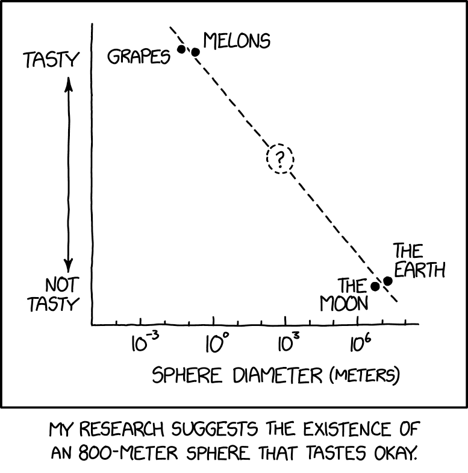

```{r}
#| include: false
library(ggplot2)
library(patchwork)
library(latex2exp)

set.seed(20261006)
theme_set(theme_minimal(base_size = 18) + theme(panel.grid.minor = element_blank()))
n <- 260
adat <- data.frame(tanulas=runif(n,2,20), elozetes=rnorm(n,60,10),
                   munka=runif(n,0,25), kor=runif(n,18,35),
                   kepzes=factor(sample(c("Nappali","Levelező","Esti"),n,TRUE),
                                 levels=c("Nappali","Levelező","Esti")))
adat$pont <- 20 + 1.6*adat$tanulas + .45*adat$elozetes - .22*adat$munka +
  ifelse(adat$kepzes=="Levelező",-3,ifelse(adat$kepzes=="Esti",2,0)) + rnorm(n,0,7)
m1 <- lm(pont~tanulas,data=adat)
m2 <- lm(pont~tanulas+elozetes+munka,data=adat)
mcat <- lm(pont~tanulas+elozetes+munka+kepzes,data=adat)
tabla <- function(m) {
  a <- as.data.frame(coef(summary(m)))
  ci <- confint(m)
  knitr::kable(data.frame(Tag=rownames(a), B=a[,1], SE=a[,2], t=a[,3],
                         p=a[,4], Also=ci[,1], Felso=ci[,2]),digits=3,row.names=FALSE)
}
adat$becsult <- fitted(m1)
adat$maradek <- resid(m1)
```

# A korrelációtól a regresszióig

## A korreláció

- ugyanazon megfigyelési egységeken mért
- két skála mérési szintű (de legalább ordinális) változó közötti
- összefüggés (együttjárás, nem okság!) vizsgálata
  + Pearson: lineáris összefüggés
  + Spearman: monoton összefüggés
- vizsgálja a kapcsolat szorosságát és irányát
  
. . .

A korreláció azt vizsgálja, *van-e (lineáris) kapcsolat két változó között*, és hogy *az milyen erős*

## A regresszió

... leírja, modellezi ezt a kapcsolatot

- a két változó közötti kapcsolatot függvényként fejezi ki
- legegyszerűbb formájában (lineáris) keresi annak az egyenesnek a paramétereit
- amellyel a két változó kapcsolata a lehető legjobban leírható

. . .

A regresszióelemzés célja lehet

- a kapcsolat *leírása*
- kimenetek *előrejelzése*: a mintán kívüli értékekre

## Tanulási célok {.smaller}

A mai alkalom végére:

- érteni a lineáris regresszió logikáját
- kézzel kiszámítani és értelmezni egy egyszerű (egyváltozós) modellt;
- becsülni az egyszerű modell segítségével és értelmezni a modell illeszkedését;

. . .

A témakör végére:

- többváltozós regressziós modelleket értelmezni;
- különbséget tenni paraméter és becslés között, értelmezni a $t$-próbákat és $F$-próbákat;
- kategorikus és ordinális változókat, interakciókat és görbületet beépíteni;
- diagnosztikai ábrák alapján kritikus modellértékelést végezni;
- felelősen közölni a regressziós eredményeket.

## A regresszió változói

- függő változó: csak skála!
- független: többféle mérési szint lehet, és lehet
  + véletlen változó
  + nem véletlen változó (pl. kísérletben)
  
. . .

Különbség a korrelációhoz képest: nem kell, hogy mindkettő valószínűségi változó legyen

## Visszatérő szociológiai példa {.smaller}

Kérdés: hogyan függ össze a tanulásra fordított idő és egy teszt pontszáma?

| Változó | Szerep | Mértékegysség |
|:--|:--|:--|
| Tesztpontszám | Kimenet: $Y$ | Pontszám |
| Heti tanulásra fordított idő | Prediktor: $X$ | Óra |
| Előzetes tudás | Kontrollváltozó | Pontszám |
| Heti munkaidő | Kontrollváltozó | Óra |
| Szak | Kategorikus prediktor | szociológia / politológia / kommunikáció |

## Először vizualizáció

```{r}
#| fig-width: 10
#| fig-height: 4.7
ggplot(adat,aes(tanulas,pont))+geom_point(alpha=.6,color="#2166ac")+
  geom_smooth(method="lm",formula=y~x,se=FALSE,color="#b2182b")+
  labs(x="Heti tanulási idő (óra)",y="Tesztpontszám")
```

Vizsgálja meg a kapcsolat irányát, alakját, a szóródást és a szokatlan eseteket.

# Az egyszerű lineáris modell

## A populációs modell {.smaller}

$$Y_i=\beta_0+\beta_1X_i+\varepsilon_i.$$

- $\beta_0$: konstans (intercept).
- $\beta_1$: populációs meredekség.
- $\varepsilon_i$: az adott eset nem modellezett része.
- $E(\varepsilon_i)=0$ és normális eloszlású

. . .

A modell a **feltételes átlagot**, nem minden egyes ember pontos kimenetét írja le.

$$E(Y_i\mid X_i=x)=\beta_0+\beta_1x.$$

## Jelölések

Többféleképpen lehetséges, de a lényeg:

- független vagy magyarázó változó (prediktor): $X$, $X_1$, $X_2$. stb.
- függő változó (kimenetel): $Y$

A kettő (vagy több) változó között függvényszerű kapcsolatot modellezünk:

- $f: X \rightarrow Y$ vagy $Y=f(X)$
- $f: X_1, X_2, \dots, X_r \rightarrow Y$ vagy $Y=f(X_1, X_2, \dots, X_r)$

## Paraméter, becslés, becsült érték {.smaller}

$$
\begin{align}
Y_i&=\beta_0+\beta_1X_i+\varepsilon_i. \\[10pt]
Y_i&=b_0+b_1X_i+e_i \\
\widehat Y_i&=b_0+b_1X_i \\
e_i&=Y_i-\widehat Y_i.
\end{align}
$$

| Jelölés | Jelentés |
|:--|:--|
| $\beta_0,\beta_1$ | Ismeretlen populációs paraméter |
| $b_0,b_1$ | Mintából kapott becslés |
| $\widehat Y_i$ | Becsült kimenet |
| $\varepsilon_i$ | Nem megfigyelhető populációs hibatag |
| $e_i$ | Megfigyelhető mintabeli maradék |

## A regresszió paraméterei

Lineáris függvény:
$$
y=ax+b \\[15pt]
\widehat Y_i=b_0+b_1X_i
$$
Mit jelent $a$ és $b$?

[Vizuálian](https://www.desmos.com/calculator)

## A regresszió paraméterei

```{r}
x <- -1:5
ex.data <- data.frame(
  x = x,
  y = 0.5*x - 1,
  z = -0.5*x + 2
)

p1 <- ggplot(data = ex.data, aes(x = x, y = y)) +
  geom_line(color = "dodgerblue", size = 1.5) +
  geom_hline(yintercept = 0) +
  geom_vline(xintercept = 0) +
  geom_segment(x = -0.1, y = -1, xend = 0.1, yend = -1) +
  geom_segment(x = 0.5, xend = 1.5, y = -0.75, yend = -0.75) +
  geom_segment(x = 1.5, xend = 1.5, y = -0.75, yend = -0.25) +
  annotate("text", x = -0.2, y = -0.9, label = TeX("$b_0$"), size = 6) +
  annotate("text", x = 1, y = -0.85, label = "1", size = 6) +
  annotate("text", x = 1.65, y = -0.5, label = TeX("$b_1$"), size = 6) +
  ylab("") + xlab("")
p2 <- ggplot(data = ex.data, aes(x = x, y = z)) +
  geom_line(color = "tomato", size = 1.5) +
  geom_hline(yintercept = 0) +
  geom_vline(xintercept = 0) +
  geom_segment(x = -0.1, y = 2, xend = 0.1, yend = 2) +
  geom_segment(x = 1, xend = 2, y = 1.5, yend = 1.5) +
  geom_segment(x = 2, xend = 2, y = 1.5, yend = 1) +
  annotate("text", x = -0.2, y = 1.9, label = TeX("$b_0$"), size = 6) +
  annotate("text", x = 1.5, y = 1.6, label = "1", size = 6) +
  annotate("text", x = 2.15, y = 1.25, label = TeX("$b_1$"), size = 6) +
  ylab("") + xlab("")
p1 + p2
```

## Mit jelentenek a paraméterek? {.smaller}

Illusztratív egyenlet:

$$\widehat{\text{P}}=40+2\cdot\text{TI}$$
A 40-es konstans a nulla tanulási óránál becsült átlag; ha nulla nem szerepel az adatok tartományában, ez extrapoláció.

A 2-es szorzótényező adja a meredekséget: egy további heti tanulási órához **átlagosan 2 ponttal magasabb becsült pontszám** társul.

- Ez nem azt jelenti, hogy minden hallgató pontosan 2 pontot nyer.
- Megfigyelési adatból nem következik automatikusan okozati hatás.
- A meredekség mértékegysége: pont / óra.

## Extrapoláció

Ha olyan tartományra adunk becslést, amely kívül esik a megfigyelt értékek tartományán.


## Interpoláció


# Becslés

## Becslés kiszámítása {.smaller}

$$b_1=\frac{\sum(X_i-\bar X)(Y_i-\bar Y)}{\sum(X_i-\bar X)^2} \\
b_0=\bar Y-b_1\bar X$$

A konstanssal illesztett OLS-egyenes átmegy a $(\bar X,\bar Y)$ ponton.

$$b_1=r\frac{s_Y}{s_X}$$

Ez a képlet összeköti a korrelációt a regresszióval: a meredekség a lineáris együttjárást az eredeti változók mértékegységébe helyezi.

## Maradékok: a függőleges eltérések

Az OLS **függőleges** eltéréseket minimalizál, nem a pontok egyenestől mért legrövidebb geometriai távolságát.

```{r}
#| fig-width: 10
#| fig-height: 4.7
kis <- adat[seq(1,nrow(adat),by=15),]
ggplot(kis,aes(tanulas,pont))+
  geom_segment(aes(xend=tanulas,yend=becsult),color="grey50")+
  geom_point(color="#2166ac",size=2.8)+
  geom_abline(intercept=coef(m1)[1],slope=coef(m1)[2],color="#b2182b",linewidth=1)+
  labs(x="Heti tanulás",y="Pontszám",caption="Az egyenes a teljes mintán illesztett modell; a pontok egy részhalmazt mutatnak.")
```

## OLS

```{r}
#| fig-width: 10
#| fig-height: 4
kis <- adat[seq(1,nrow(adat),by=15),]
ggplot(kis,aes(tanulas,pont))+
  geom_point(color="#2166ac",size=2.8)+
  geom_abline(intercept=coef(m1)[1],slope=coef(m1)[2],color="#b2182b",linewidth=1)+
  geom_rect(aes(xmin=tanulas,ymin=becsult, xmax=tanulas+abs(maradek), ymax=pont),fill="red", alpha=0.2)+
  labs(x="Heti tanulás",y="Pontszám")
```

[Itt jobban látszik](https://morauszkia.github.io/stat2sz/regresszio.html) 

[Interaktív vizualizáció](https://seeing-theory.brown.edu/regression-analysis/index.html#section1)

## Miért legkisebb négyzetek? {.smaller}

Az OLS azokat az együtthatókat választja, amelyek minimalizálják:

$$SSE=\sum_{i=1}^n e_i^2=\sum_{i=1}^n(Y_i-b_0-b_1X_i)^2.$$

- A pozitív és negatív maradékok nem oltják ki egymást.
- A nagy eltérések négyzetesen nagy büntetést kapnak.
- Emiatt az OLS érzékeny lehet befolyásos esetekre.

## Korreláció és regresszió

| Korreláció | Regresszió |
|:--|:--|
| Szimmetrikus: $r_{XY}=r_{YX}$ | Meghatározott kimenetet modellez |
| Mértékegység nélküli | A meredekségnek mértékegysége van |
| Együttjárás erőssége | Feltételes átlag és előrejelzés |
| Nem ad becslési egyenletet | Becsült értékeket ad |

A parciális korreláció két maradék kapcsolata. A többszörös regresszió ugyanennek a kiigazításnak a logikáját is használja.

# Összegzés és kitekintés

## A regresszió {.smaller}

- A Pearson-féle korreláció két skála mérési szintű változó lineáris összefüggését mérte;
- A regresszió modellezi ezt a kapcsolatot;
- Keresi annak az egyenesnek a paramétereit, amely alapján végzett becslések és a tényleges értékek négyzetes eltéréseinek összege minimális;
- A kapott egyenes használható a mintán kívüli értékekkel való becslésre;
- De: óvatosan becsüljünk olyan értékekre, amelyek nem esnek a megfigyelt értékek tartományába!

## A következő óra anyagából

**Modellilleszkedés**

Mennyit magyaráz a modell a kimeneti változó varianciájából?

**Hipotézisvizsgálat**

A mintában megfigyelt kapcsolat alapján mit állíthatunk a sokasági kapcsolatra vonatkozóan?

**Az előrejelzés bizonytalansága**

Milyen határok között van a tényleges feltételes átlag? Milyen értékek közé eshetnek az újabb megfigyelések? Milyen értékek közé esik az összes egyedi eset meghatározott része?